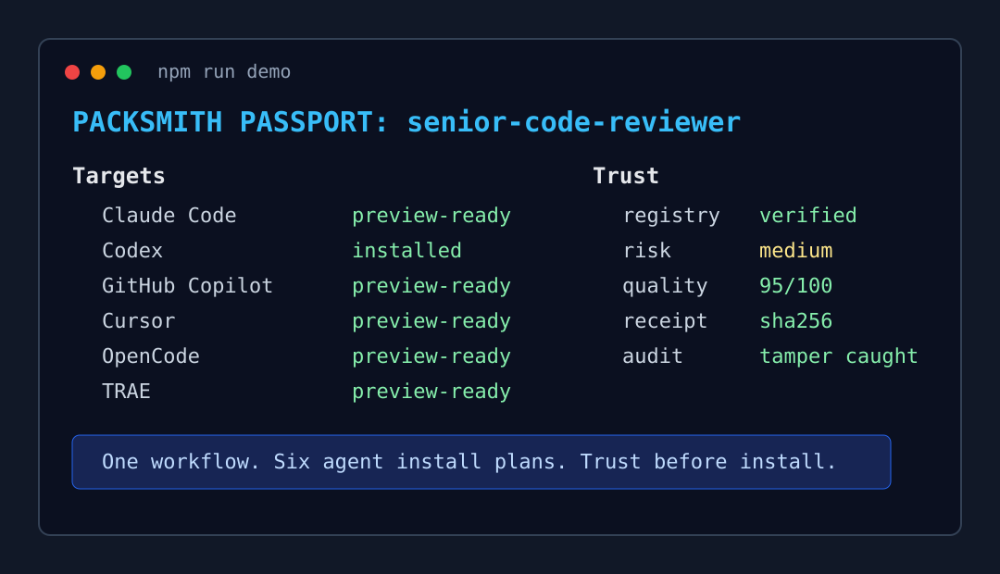

# Packsmith Hackathon Demo

This is the short, high-signal demo for judges:

> One workflow. Six agent install plans. One isolated install. Trust before install.

Packsmith should not be presented as just another CLI. Present it as the package manager and trust gate for reusable AI agent workflows.

## 60-Second Path

Run the isolated demo, then pause on the Passport:

```bash
npm run demo
npm run verify:hackathon:quick
node src/cli.mjs passport senior-code-reviewer
node src/cli.mjs preview senior-code-reviewer --all-targets
```

Recommended live flow:

```text
search review -> preview --all-targets -> Codex preview -> isolated install -> prepared transcript -> tamper audit -> Passport
```

The first sentence should be:

```text
Packsmith is the package manager for AI agent workflows: one workflow, six agent install plans, trust before install.
```

## Passport Moment

End the demo on the one-screen passport. This is the screenshot judges should remember:



```text
PACKSMITH PASSPORT: senior-code-reviewer

Targets:
Claude Code       preview-ready
Codex             installed
GitHub Copilot    preview-ready
Cursor            preview-ready
OpenCode          preview-ready
TRAE              preview-ready

Trust:
Registry metadata verified yes
Risk              medium
Permissions       shell optional, filesystem required, network optional, browser none
Quality Score     95/100
Install receipt   checksum sha256-...
Audit             tamper caught
```

## Run The Demo

```bash
npm ci
npm run demo
npm run verify:hackathon:quick
```

Equivalent direct script:

```bash
node scripts/hackathon-demo.mjs
```

Requires Node 20+. For a repeatable manual run, pin the demo root:

```bash
PACKSMITH_DEMO_ROOT=/tmp/packsmith-hackathon-demo node scripts/hackathon-demo.mjs
```

PowerShell:

```powershell
$env:PACKSMITH_DEMO_ROOT = Join-Path $env:TEMP "packsmith-hackathon-demo"
node scripts/hackathon-demo.mjs
```

The script derives:

- `PACKSMITH_HOME=<demo-root>/state`
- `PACKSMITH_TEST_HOME=<demo-root>/home`

That keeps the demo away from the real user home, real `.codex`, and real `.packsmith` directories.

## Story Beats

1. Discover reusable workflows:

   ```bash
   node src/cli.mjs search review
   ```

2. Show the cross-agent surface:

   ```bash
   node src/cli.mjs targets
   ```

3. Show the trust gate before writes:

   ```bash
   node src/cli.mjs preview senior-code-reviewer --target claude-code
   node src/cli.mjs preview senior-code-reviewer --target codex
   node src/cli.mjs preview senior-code-reviewer --target github-copilot --scope personal
    node src/cli.mjs preview senior-code-reviewer --target cursor
    node src/cli.mjs preview senior-code-reviewer --target opencode
    node src/cli.mjs preview senior-code-reviewer --target trae
   ```

4. Show the quick score, then the full doctor report:

   ```bash
   node src/cli.mjs score senior-code-reviewer
   node src/cli.mjs doctor official-packs/senior-code-reviewer
   ```

5. Install into the isolated Codex home.
6. Show the user-value beat:

   ```text
   Use senior-code-reviewer to review my current changes.
   ```

   This review output is a prepared transcript from the installed workflow, so judges can inspect the behavior without waiting on a live model call.

   Expected visible effect: Codex now has the installed `senior-code-reviewer` workflow under the isolated `.codex/skills` directory and can be asked to run that review flow. In a live Codex session, the first useful response should inspect the current diff, call out risks and missing tests, and cite concrete files rather than giving generic review advice.

7. Tamper with the installed pack, then prove `audit --ci` catches the checksum mismatch.
8. End on the Packsmith Passport summary.

The final line should land the product:

```text
Packsmith is not just an installer; it is a trust gate for agent workflows.
```

## Two-Minute Talk Track

0:00-0:15

AI agents are multiplying, but their skills are scattered across different folders, formats, and trust models. Packsmith makes one reusable workflow portable across the agents developers already use.

0:15-0:35

Run `npm run demo`. Search for a real code-review workflow and show the target list. This proves Packsmith is a registry and compatibility layer, not a single-agent prompt folder.

0:35-1:00

Pause on preview. The important move is that Packsmith shows exact writes, permissions, risk, publisher, checksum, and verified metadata before installation.

1:00-1:20

Show `score` first for the one-screen quality number, then `doctor` for detail. Packsmith scores trigger quality, instruction safety, output contract, context pressure, portability, and maintainability.

1:20-1:45

Let the script install into the isolated Codex home. Say the actual user prompt out loud: `Use senior-code-reviewer to review my current changes.` Then tamper with the installed pack and run `audit --ci`. The checksum mismatch is the supply-chain moment.

1:45-2:00

Close on the Passport. The line is: one workflow, six agent install plans, one isolated install, trust before install.

## Safety Notes

- The demo runner installs only under `PACKSMITH_TEST_HOME`, which defaults to a temporary demo root.
- `preview` is a read-only install plan. It shows exact writes, permissions, risk, checksum, source, publisher, and verified metadata before installation.
- `audit --ci` is expected to fail during the tamper step. The runner catches that non-zero exit and treats `checksum mismatch` as the successful proof.
- `Registry metadata verified` is catalog metadata, not cryptographic signing.
- Permission metadata is used for preview, policy, and audit visibility. It is not a sandbox.
- Claude Code, GitHub Copilot, Cursor, OpenCode, and TRAE are previews in this demo; they do not write their target directories. Passport `preview-ready` means the target has a generated install plan, not that it was installed.

## Verification

Use the quick gate before a live demo:

```bash
npm run verify:hackathon:quick
```

Use the full CI/release gate before tagging or publishing:

```bash
npm run verify:hackathon:ci
```
